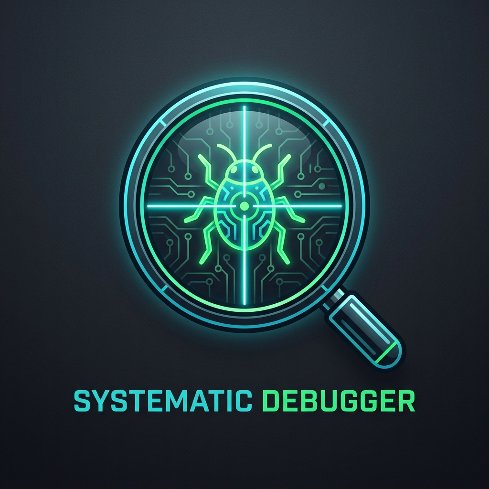

<p align="center">
  
</p>

<h1 align="center">Systematic Debugger for Google Antigravity</h1>

<p align="center">
  <b>Evidence-Driven Root Cause Analysis & Scientific Debugging Methodology for AI Coding Agents</b>
</p>

---

## Overview

AI coding assistants frequently fall into the trap of **"guess-and-check"** debugging—proposing speculative patches, slapping cosmetic null-checks, or modifying code blindly until an error disappears.

**Systematic Debugger** is a Google Antigravity plugin that enforces the **Scientific Method** on every bug investigation:
1. **Hypothesis Formulation**: Requires at least 3 competing hypotheses before modifying code.
2. **Minimal Reproduction**: Isolates the bug into a runnable, failing test case first.
3. **5-Whys Root Cause Drill**: Eliminates symptomatic band-aids to target fundamental failure points.
4. **Adversarial Subagent Verification**: Leverages Antigravity's `invoke_subagent` to pit a `Critic / Breaker` subagent against proposed fixes before sign-off.

---

## 5-Phase Investigation Lifecycle

```
[Phase 1: Clarify & Capture] ──> Record Expected vs Actual & telemetry in Artifacts
         │
[Phase 2: Formulate Hypotheses] ──> Generate 3 competing hypotheses (Logic / Boundary / Env)
         │
[Phase 3: Minimal Repro Isolation] ──> Create isolated failing test script
         │
[Phase 4: Telemetry & 5-Whys] ──> Binary-search execution path & find root cause
         │
[Phase 5: Fix & Red-Team] ──> Subagent adversarial review & permanent regression test
```

---

## How to Use

### Trigger Commands
Simply invoke any of the following in your chat prompt:
* `/debug [error message or unexpected behavior]`
* `debug this: [paste stack trace]`
* `investigate root cause for [issue]`

#### Example Prompt:
> `/debug The authentication token refresh intermittently returns 401 on concurrent API calls. Do not guess; follow the systematic debugging workflow.`

---

## Installation

Clone this repository into your Antigravity plugins directory:

```bash
git clone https://github.com/davigmacode/systematic-debugger.git ~/.gemini/config/plugins/systematic-debugger
```

Restart Google Antigravity or your IDE to activate the plugin.

---

## Directory Structure

```text
systematic-debugger/
├── assets/
│   └── logo.png              # Diagnostic emblem
├── skills/
│   └── systematic-debugger/
│       └── SKILL.md          # Scientific debugging instructions & subagent directives
├── plugin.json               # Antigravity plugin manifest
└── README.md                 # Documentation
```

---

## License

MIT © [Irfan Vigma Taufik (davigmacode)](https://github.com/davigmacode)
